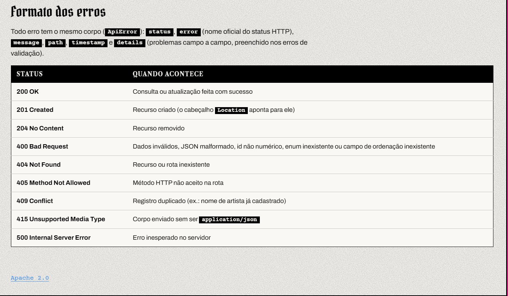
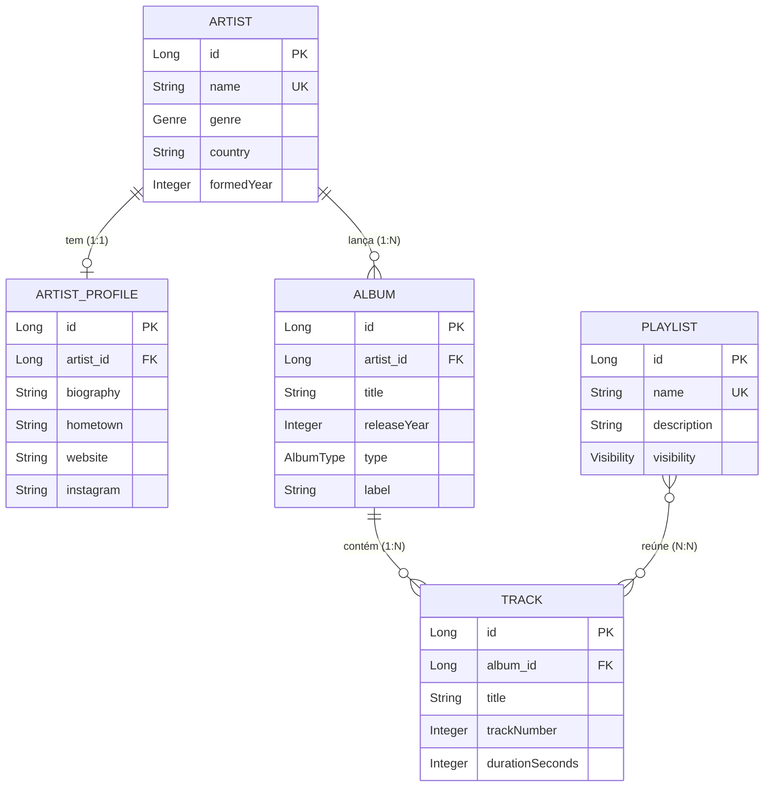

# Scene API

API REST de catálogo musical em **Java 21** e **Spring Boot**: artistas, perfis, álbuns, faixas e playlists, com os três tipos de relacionamento (1:1, 1:N e N:N), paginação, validação, links HATEOAS e documentação Swagger.

> Projeto final da disciplina de **Web Services** (Senac TSI) — **Parte 1**, entregue em out/2026.

**40 endpoints** · **87 requisições no Postman** (43 delas de erro) · **105 registros de exemplo** carregados ao subir


---

## Índice

- [Destaques](#destaques)
- [Como executar](#como-executar)
- [Dados iniciais](#dados-iniciais)
- [Modelo de dados](#modelo-de-dados)
- [Convenções da API](#convenções-da-api)
- [Regras de validação](#regras-de-validação)
- [API Reference](#api-reference)
- [Consultas no Console do H2](#consultas-no-console-do-h2)
- [Estrutura do projeto](#estrutura-do-projeto)
- [Autor](#autor)

## Destaques

- **Arquitetura em camadas:** `controller` → `service` → `repository`, com DTOs separados para entrada (`*Request`) e saída (`*Response`). As entidades JPA não vazam para fora da API.
- **Os três relacionamentos do enunciado:** 1:1 (artista ↔ perfil), 1:N (artista → álbuns → faixas) e N:N (playlists ↔ faixas), cada um com endpoints próprios de consulta.
- **Erros padronizados:** um `GlobalExceptionHandler` devolve sempre o mesmo corpo, com a lista campo a campo nos erros de validação. Oito status diferentes, cada um com o seu caso. ([detalhes](#erros))
- **Validação em dois níveis:** as mesmas regras nos DTOs de entrada e nas entidades (Bean Validation), com expressões regulares compartilhadas em `validation/`.
- **HATEOAS (HAL):** cada recurso traz `_links` para si mesmo, para a coleção e para os recursos relacionados; as listagens vêm em `PagedModel`.
- **Paginação e ordenação** em todas as listagens, inclusive nas buscas e nas consultas por relação.
- **Testado:** teste automatizado que sobe o contexto inteiro do Spring e coleção do Postman com testes de status, de corpo e de links — incluindo 43 casos de erro.

### Tecnologias

| Camada | O que foi usado |
| :-- | :-- |
| Linguagem e build | Java 21 · Maven (wrapper `mvnw`) |
| Framework | Spring Boot 4.1.1 · Spring Web MVC · Spring Data JPA · Hibernate |
| Validação | Bean Validation (Jakarta Validation) |
| Hipermídia | Spring HATEOAS (formato HAL) |
| Banco | H2 (em memória) |
| Documentação | Springdoc OpenAPI / Swagger UI 3.1.1, com tema customizado |

## Como executar

Requisito: **JDK 21 ou superior**. O Maven já vem junto no projeto (`mvnw`), então não precisa instalar nada além do JDK.

```bash
# Linux / macOS
./mvnw spring-boot:run

# Windows
mvnw.cmd spring-boot:run
```

A API sobe em `http://localhost:8080`; abrir a raiz já redireciona para o Swagger.

| Recurso | URL |
| :-- | :-- |
| Swagger UI | http://localhost:8080/swagger-ui/index.html |
| OpenAPI (JSON) | http://localhost:8080/v3/api-docs |
| Console do H2 | http://localhost:8080/h2-console |

No Console do H2: JDBC URL `jdbc:h2:mem:scenedb`, usuário `sa`, senha em branco.

O Swagger UI tem tema próprio e traz, além dos 40 endpoints, o modelo de dados, as convenções de paginação e a tabela de status:

<!-- Captura dos endpoints: abra o grupo ARTISTAS no Swagger (deixando os endpoints recolhidos),
     tire o print e salve como docs/swagger-endpoints.png; depois descomente a linha abaixo.
      -->



Para rodar o teste automatizado (sobe o contexto inteiro com o H2 e a carga inicial):

```bash
./mvnw test
```

### Coleção do Postman

A coleção está em [`postman/scene-api.postman_collection.json`](postman/scene-api.postman_collection.json): **87 requisições** — os 40 endpoints, 4 passos extras de fluxo e 43 casos de erro (`400`, `404`, `405`, `409` e `415`) —, agrupadas em 7 pastas.

1. No Postman: **Import** → selecione o arquivo `.json`.
2. Suba a aplicação (`http://localhost:8080`). A variável `baseUrl` já vem configurada.
3. Rode as pastas **1 a 7**, de cima para baixo (ou use o **Collection Runner**).

Os ids criados são guardados automaticamente em variáveis (`artistId`, `profileId`, `albumId`, `trackId`, `track2Id` e `playlistId`), e cada requisição tem testes de status, de corpo e de links HATEOAS.

| Pasta | O que faz |
| :-- | :-- |
| 1. Artists | CRUD de artistas, buscas e erros de validação |
| 2. Artist Profiles | Perfil do artista criado na pasta 1 (relação 1:1) |
| 3. Albums | Álbuns do artista (relação 1:N) |
| 4. Tracks | Faixas do álbum (relação 1:N) |
| 5. Playlists | Playlists e faixas dentro delas (relação N:N) |
| 6. Erros gerais | Rota inexistente, método e Content-Type errados, JSON ruim, ordenação inválida |
| 7. Limpeza | Remove o que foi criado e confere as cascatas; depois dela a coleção roda de novo do zero |

## Dados iniciais

O H2 é **em memória**: os dados somem ao encerrar a aplicação. Por isso, ao subir — e somente se ainda não houver nenhum artista —, a classe `DataLoader` cadastra automaticamente:

| Quantidade | O quê | Observação |
| --: | :-- | :-- |
| 6 | artistas | Bring Me the Horizon, Title Fight, Asking Alexandria, blessthefall, Alesana e I Promised the World |
| 5 | perfis | o de *I Promised the World* fica de fora de propósito, para dar para testar o `POST /artist-profiles` e o `404` por artista |
| 8 | álbuns | inclui um EP sem faixas, que serve para testar a consulta por formato |
| 82 | faixas | com número e duração |
| 4 | playlists | *Heavy Rotation* (PUBLIC), *Treino Pesado* (PRIVATE), *Curtas e Grossas* (PUBLIC) e *Madrugada* (PRIVATE), ligando faixas de álbuns diferentes |

Os artistas saem do perfil do autor no Last.fm. Gravadoras, sites e Instagram foram conferidos em fontes públicas (Wikipedia e sites oficiais); o que não foi confirmado fica `null`, porque `label`, `website` e `instagram` são campos opcionais.

## Modelo de dados



| Entidade | Descrição | Relacionamentos |
| :-- | :-- | :-- |
| `Artist` | Artista ou banda | 1:1 com `ArtistProfile`; 1:N com `Album` |
| `ArtistProfile` | Biografia, cidade natal, site e Instagram do artista | 1:1 com `Artist` |
| `Album` | Álbum, EP, single, coletânea ou show ao vivo | N:1 com `Artist`; 1:N com `Track` |
| `Track` | Faixa de um álbum | N:1 com `Album`; N:N com `Playlist` |
| `Playlist` | Lista de faixas de qualquer artista ou álbum | N:N com `Track` (tabela `playlist_tracks`) |

**Enums:** `Genre` (`ROCK`, `ALTERNATIVE`, `PUNK`, `EMO`, `POST_HARDCORE`, `METALCORE`, `METAL`, `POP`, `HIP_HOP`, `ELECTRONIC`, `JAZZ`, `FOLK`, `CLASSICAL`, `OTHER`) · `AlbumType` (`ALBUM`, `EP`, `SINGLE`, `COMPILATION`, `LIVE`) · `Visibility` (`PUBLIC`, `PRIVATE`).

### Decisões e limitações do modelo

O modelo é uma simplificação de propósito: cobre os três tipos de relacionamento do enunciado sem complicar a API. O que ele **não** representa:

- **Álbum com vários artistas.** Cada álbum pertence a um artista. Colaborações, splits e coletâneas de "vários artistas" exigiriam um N:N entre `Album` e `Artist`, com uma tabela de ligação.
- **Participações especiais (feat.).** A faixa não tem artistas próprios; ela pertence ao álbum e, por ele, a um artista. Representar participações exigiria um N:N entre `Track` e `Artist`.
- **A mesma música em mais de um lançamento.** `Track` é a faixa dentro de um álbum, EP ou single, como nos serviços de streaming, em que cada lançamento lista as suas próprias faixas. Uma música lançada como single e depois no álbum vira duas faixas, uma em cada lançamento. Um modelo mais completo separaria a música (a gravação) da faixa no lançamento.
- **Artistas históricos.** `formedYear` aceita de 1000 a 2100, para caberem, por exemplo, compositores clássicos; em artista solo, vale o ano de início da carreira.

## Convenções da API

### Paginação e ordenação

Todas as listagens — inclusive as buscas e as consultas por relação — são paginadas e aceitam os mesmos parâmetros de query:

| Parâmetro | Tipo | Descrição |
| :-- | :-- | :-- |
| `page` | `integer` | Número da página, começando em 0 (padrão `0`) |
| `size` | `integer` | Itens por página (padrão `10`, máximo `50`) |
| `sort` | `string` | Ordenação no formato `campo,asc` ou `campo,desc`, ex.: `sort=name,asc` |

Os campos aceitos em `sort` são os do recurso **devolvido** pelo endpoint:

| Recurso devolvido | Campos de ordenação |
| :-- | :-- |
| `Artist` | `id`, `name`, `genre`, `country`, `formedYear` |
| `ArtistProfile` | `id`, `hometown`, `website`, `instagram` |
| `Album` | `id`, `title`, `releaseYear`, `type`, `label` |
| `Track` | `id`, `title`, `trackNumber`, `durationSeconds` |
| `Playlist` | `id`, `name`, `description`, `visibility` |

Um campo de ordenação que não existe devolve `400`.

> Nos dois endpoints que atravessam o N:N, valem os campos do recurso devolvido, e não os do recurso do caminho: `GET /playlists/{id}/tracks` devolve faixas, então ordena por campos de `Track`; `GET /tracks/{id}/playlists` devolve playlists, então ordena por campos de `Playlist`.

### Listas vazias, remoções e valores inválidos

- **Lista vazia não é erro.** Quando a consulta não encontra nada (nenhum artista de um gênero, uma faixa que não está em nenhuma playlist, uma busca sem resultado), a resposta é `200 OK` com a página vazia: `_embedded` ausente e `page.totalElements = 0`. O `404` fica para quando o **recurso pedido pelo id** não existe; por exemplo, `GET /tracks/999/playlists` devolve `404` se a faixa 999 não existir, mas `200` com página vazia se ela existir e não estiver em nenhuma playlist.
- **Remoção devolve `204 No Content`, sem corpo.** Pelo HTTP, o `204` significa "deu certo e não há nada a devolver"; o próprio status é a confirmação. Se o id não existir ou for inválido, a resposta é `404` ou `400`, com o corpo de erro padrão.
- **Enum inválido só aparece fora do Swagger.** No Swagger UI o gênero (e o tipo de álbum e a visibilidade) é uma lista de opções, então não dá para enviar um valor que não existe. O `400` acontece quando a requisição é feita por outro meio (Postman, navegador, curl), por exemplo `GET /artists/by-genre/SAMBA`.
- **Cidade natal e país são validados só no formato.** `hometown` e `country` aceitam apenas letras (com acentos), espaço, ponto, vírgula, apóstrofo e hífen, e têm tamanho limitado. A API não consulta nenhuma base de lugares, então ela não sabe se a cidade existe de verdade.

### Links HATEOAS

Cada recurso traz `_links` com `self`, `update` e `delete`, a coleção e os recursos relacionados. As listagens vêm em `PagedModel` (itens em `_embedded`, mais `_links` de navegação e o bloco `page`).

```json
{
  "id": 1,
  "name": "Bring Me the Horizon",
  "genre": "METALCORE",
  "country": "United Kingdom",
  "formedYear": 2004,
  "_links": {
    "self":    { "href": "http://localhost:8080/artists/1" },
    "update":  { "href": "http://localhost:8080/artists/1" },
    "delete":  { "href": "http://localhost:8080/artists/1" },
    "artists": { "href": "http://localhost:8080/artists" },
    "albums":  { "href": "http://localhost:8080/albums/by-artist/1" },
    "profile": { "href": "http://localhost:8080/artist-profiles/by-artist/1" }
  }
}
```

### Erros

Todo erro tem o mesmo corpo; `details` só vem preenchida nos erros de validação:

```json
{
  "status": 404,
  "error": "Not Found",
  "message": "Artista não encontrado(a) com id: 99",
  "path": "/artists/99",
  "timestamp": "2026-10-09T10:15:30",
  "details": []
}
```

Erro de validação, campo a campo:

```json
{
  "status": 400,
  "error": "Bad Request",
  "message": "Dados inválidos: 2 campo(s) com problema",
  "path": "/artists",
  "timestamp": "2026-10-09T10:15:30",
  "details": [
    { "field": "genre", "message": "não deve ser nulo" },
    { "field": "name", "message": "tamanho deve ser entre 2 e 100" }
  ]
}
```

| Status | Quando |
| :-- | :-- |
| `200 OK` | Consulta ou atualização bem-sucedida |
| `201 Created` | Recurso criado (o header `Location` aponta para ele) |
| `204 No Content` | Remoção bem-sucedida |
| `400 Bad Request` | Validação falhou, JSON malformado ou com texto onde se espera número, id ou enum inválido, parâmetro ausente ou em branco, campo de ordenação inexistente |
| `404 Not Found` | Recurso (ou artista/álbum/playlist/faixa referenciado) não existe, ou rota inexistente |
| `405 Method Not Allowed` | Verbo HTTP não suportado pela rota |
| `409 Conflict` | Valor único duplicado (nome de artista ou playlist, título de álbum no mesmo artista, número de faixa no mesmo álbum, perfil repetido, faixa já na playlist) |
| `415 Unsupported Media Type` | Corpo enviado com um Content-Type diferente de `application/json` |
| `500 Internal Server Error` | Só para falhas inesperadas, com mensagem genérica (nenhum dos casos acima chega aqui) |

## Regras de validação

As mesmas regras valem na entrada (DTOs `*Request`) e nas entidades (Bean Validation). Textos são aparados (`trim`) antes de validar.

<details>
<summary><b>Tabela completa de validações</b></summary>

| Entidade | Campo | Regra |
| :-- | :-- | :-- |
| `Artist` | `name` | obrigatório; 2 a 100 caracteres; ao menos uma letra; único (sem diferenciar maiúsculas de minúsculas) |
| `Artist` | `genre` | obrigatório; enum `Genre` |
| `Artist` | `country` | opcional; 2 a 60 caracteres; somente letras, espaços e `. , ' -` |
| `Artist` | `formedYear` | opcional; de 1000 a 2100 (cabem artistas históricos, como compositores clássicos) |
| `ArtistProfile` | `artistId` | obrigatório; o artista precisa existir e ainda não ter perfil (1:1); não muda depois de criado |
| `ArtistProfile` | `biography` | obrigatório; 10 a 1000 caracteres |
| `ArtistProfile` | `hometown` | opcional; 2 a 100 caracteres; somente letras, espaços e `. , ' -` |
| `ArtistProfile` | `website` | opcional; até 200 caracteres; começa com `http://` ou `https://` |
| `ArtistProfile` | `instagram` | opcional; até 30 caracteres entre letras, números, `.` e `_` (sem o `@`) |
| `Album` | `artistId` | obrigatório; o artista precisa existir |
| `Album` | `title` | obrigatório; 1 a 150 caracteres; títulos numéricos como `1989` valem; único dentro do artista |
| `Album` | `releaseYear` | obrigatório; de 1900 a 2100 |
| `Album` | `type` | obrigatório; enum `AlbumType` |
| `Album` | `label` | opcional; 2 a 100 caracteres; ao menos uma letra |
| `Track` | `albumId` | obrigatório; o álbum precisa existir |
| `Track` | `title` | obrigatório; 1 a 150 caracteres; títulos numéricos como `27` valem |
| `Track` | `trackNumber` | obrigatório; de 1 a 99; único dentro do álbum |
| `Track` | `durationSeconds` | opcional; de 1 a 7200 |
| `Playlist` | `name` | obrigatório; 2 a 100 caracteres; ao menos uma letra; único (sem diferenciar maiúsculas de minúsculas) |
| `Playlist` | `description` | opcional; até 255 caracteres |
| `Playlist` | `visibility` | obrigatório; enum `Visibility` |

</details>

## API Reference

São **40 endpoints**, em 5 grupos. A descrição completa de cada um, com exemplos de resposta de cada status, está no **Swagger UI**. Todas as listagens aceitam `page`, `size` e `sort` ([convenções](#paginação-e-ordenação)).

<details>
<summary><b>Artists</b> — 7 endpoints · cadastro de artistas e bandas</summary>

Um artista tem vários álbuns (1:N) e no máximo um perfil (1:1).

Campos de ordenação: `id`, `name`, `genre`, `country`, `formedYear`.

#### Corpo da requisição (usado no `POST` e no `PUT`)

| Campo | Tipo | Descrição |
| :-- | :-- | :-- |
| `name` | `string` | **Obrigatório.** Nome do artista ou banda (único, sem diferenciar maiúsculas de minúsculas). De 2 a 100 caracteres, com ao menos uma letra; aceita números e pontuação comum. |
| `genre` | `string` | **Obrigatório.** Gênero principal. Valores: `ROCK`, `ALTERNATIVE`, `PUNK`, `EMO`, `POST_HARDCORE`, `METALCORE`, `METAL`, `POP`, `HIP_HOP`, `ELECTRONIC`, `JAZZ`, `FOLK`, `CLASSICAL`, `OTHER` |
| `country` | `string` | Opcional. De 2 a 60 caracteres, somente letras, espaços e `. , ' -` (números não são aceitos). |
| `formedYear` | `integer` | Opcional. Ano de formação da banda ou, em artista solo, de início da carreira. De 1000 a 2100. |

```json
{
  "name": "Sleeping with Sirens",
  "genre": "POST_HARDCORE",
  "country": "United States",
  "formedYear": 2009
}
```

---

```http
GET /artists
```
Retorna uma página com os artistas cadastrados. · `200` · `400`

```http
GET /artists/search?name=${name}
```
Consulta personalizada: artistas cujo nome contém o texto informado, sem diferenciar maiúsculas de minúsculas (ex.: `name=bring` encontra "Bring Me the Horizon"). O parâmetro `name` é **obrigatório**, de 1 a 100 caracteres. · `200` · `400`

```http
GET /artists/by-genre/${genre}
```
Consulta personalizada: artistas do gênero informado (valores do enum `Genre`). · `200` · `400`

```http
GET /artists/${id}
```
Dados de um único artista, com links para álbuns e perfil. · `200` · `400` · `404`

```http
POST /artists
```
Cria um artista. · `201` · `400` · `409`

```http
PUT /artists/${id}
```
Substitui todos os dados de um artista existente; mesmas regras do cadastro. · `200` · `400` · `404` · `409`

```http
DELETE /artists/${id}
```
Exclui o artista junto com o perfil, os álbuns e as faixas dele. As faixas também saem de todas as playlists. · `204` · `400` · `404`

</details>

<details>
<summary><b>Artist Profiles</b> — 7 endpoints · perfil detalhado do artista (1:1)</summary>

Biografia, cidade natal, site e Instagram. Cada artista tem no máximo um perfil.

Campos de ordenação: `id`, `hometown`, `website`, `instagram`.

#### Corpo da requisição (usado no `POST` e no `PUT`)

| Campo | Tipo | Descrição |
| :-- | :-- | :-- |
| `artistId` | `integer` | **Obrigatório.** Id do artista dono do perfil. O artista precisa existir e ainda não ter perfil; depois de criado, o perfil não muda de artista. |
| `biography` | `string` | **Obrigatório.** De 10 a 1000 caracteres. |
| `hometown` | `string` | Opcional. De 2 a 100 caracteres, somente letras, espaços e `. , ' -`. |
| `website` | `string` | Opcional. Precisa começar com `http://` ou `https://`; até 200 caracteres. |
| `instagram` | `string` | Opcional. Usuário sem o `@`, até 30 caracteres: letras, números, ponto e underline. |

```json
{
  "artistId": 6,
  "biography": "Banda de Denton, Texas, formada em 2020, que já se chamou Sw!tch e Sinema.",
  "hometown": "Denton, Texas",
  "website": "https://www.example.com",
  "instagram": "iptw.example"
}
```

---

```http
GET /artist-profiles
```
Retorna uma página com os perfis cadastrados. · `200` · `400`

```http
GET /artist-profiles/search?hometown=${hometown}
```
Consulta personalizada: perfis cuja cidade natal contém o texto informado (ex.: `hometown=england` encontra "Sheffield, England" e "York, England"). O parâmetro é **obrigatório**, de 1 a 100 caracteres. · `200` · `400`

```http
GET /artist-profiles/by-artist/${artistId}
```
Consulta personalizada: o perfil do artista informado (relação 1:1). · `200` · `400` · `404`

```http
GET /artist-profiles/${id}
```
Dados de um único perfil. · `200` · `400` · `404`

```http
POST /artist-profiles
```
Cria o perfil de um artista que ainda não tem um. · `201` · `400` · `404` · `409`

```http
PUT /artist-profiles/${id}
```
Substitui os dados de um perfil existente. O `artistId` enviado precisa ser o mesmo do perfil. · `200` · `400` · `404`

```http
DELETE /artist-profiles/${id}
```
Exclui o perfil. O artista continua cadastrado e pode receber um novo perfil depois. · `204` · `400` · `404`

</details>

<details>
<summary><b>Albums</b> — 8 endpoints · álbuns, EPs, singles, coletâneas e shows ao vivo</summary>

Cada álbum pertence a um artista (N:1) e tem várias faixas (1:N).

Campos de ordenação: `id`, `title`, `releaseYear`, `type`, `label`.

#### Corpo da requisição (usado no `POST` e no `PUT`)

| Campo | Tipo | Descrição |
| :-- | :-- | :-- |
| `artistId` | `integer` | **Obrigatório.** Id do artista dono do álbum (o artista precisa existir). |
| `title` | `string` | **Obrigatório.** De 1 a 150 caracteres: letras, números, espaços e pontuação comum (títulos numéricos como "1989" são válidos). Não pode repetir dentro do mesmo artista. |
| `releaseYear` | `integer` | **Obrigatório.** De 1900 a 2100. |
| `type` | `string` | **Obrigatório.** Valores: `ALBUM`, `EP`, `SINGLE`, `COMPILATION`, `LIVE`. |
| `label` | `string` | Gravadora (opcional). De 2 a 100 caracteres, com ao menos uma letra. |

```json
{
  "artistId": 1,
  "title": "That's the Spirit",
  "releaseYear": 2015,
  "type": "ALBUM",
  "label": "RCA Records"
}
```

---

```http
GET /albums
```
Retorna uma página com os álbuns cadastrados. · `200` · `400`

```http
GET /albums/search?title=${title}
```
Consulta personalizada: álbuns cujo título contém o texto informado (ex.: `title=scream` encontra "Stand Up and Scream"). O parâmetro é **obrigatório**, de 1 a 150 caracteres. · `200` · `400`

```http
GET /albums/by-artist/${artistId}
```
Consulta personalizada: os álbuns do artista informado (relação 1:N). · `200` · `400` · `404`

```http
GET /albums/by-type/${type}
```
Consulta personalizada: os álbuns do formato informado (enum `AlbumType`). · `200` · `400`

```http
GET /albums/${id}
```
Dados de um único álbum, com links para o artista e as faixas. · `200` · `400` · `404`

```http
POST /albums
```
Cria um álbum para um artista existente. · `201` · `400` · `404` · `409`

```http
PUT /albums/${id}
```
Substitui todos os dados de um álbum existente, inclusive o artista dono. · `200` · `400` · `404` · `409`

```http
DELETE /albums/${id}
```
Exclui o álbum junto com as faixas dele. As faixas também saem de todas as playlists. · `204` · `400` · `404`

</details>

<details>
<summary><b>Tracks</b> — 8 endpoints · faixas dos álbuns</summary>

Cada faixa pertence a um álbum (N:1) e pode estar em várias playlists (N:N).

Campos de ordenação: `id`, `title`, `trackNumber`, `durationSeconds`.

#### Corpo da requisição (usado no `POST` e no `PUT`)

| Campo | Tipo | Descrição |
| :-- | :-- | :-- |
| `albumId` | `integer` | **Obrigatório.** Id do álbum da faixa (o álbum precisa existir). |
| `title` | `string` | **Obrigatório.** De 1 a 150 caracteres: letras, números, espaços e pontuação comum (títulos numéricos como "27" são válidos). |
| `trackNumber` | `integer` | **Obrigatório.** De 1 a 99. Não pode repetir dentro do mesmo álbum. |
| `durationSeconds` | `integer` | Opcional. De 1 a 7200. |

```json
{
  "albumId": 8,
  "title": "Intro",
  "trackNumber": 1,
  "durationSeconds": 95
}
```

---

```http
GET /tracks
```
Retorna uma página com as faixas cadastradas. · `200` · `400`

```http
GET /tracks/search?title=${title}
```
Consulta personalizada: faixas cujo título contém o texto informado (ex.: `title=heart` encontra "Can You Feel My Heart"). O parâmetro é **obrigatório**, de 1 a 150 caracteres. · `200` · `400`

```http
GET /tracks/by-album/${albumId}
```
Consulta personalizada: as faixas do álbum informado (relação 1:N). Use `sort=trackNumber,asc` para a ordem do disco. · `200` · `400` · `404`

```http
GET /tracks/${id}/playlists
```
Consulta personalizada: as playlists em que a faixa aparece (relação N:N). Devolve playlists, então ordena por `id`, `name`, `description` ou `visibility`. · `200` · `400` · `404`

```http
GET /tracks/${id}
```
Dados de uma única faixa, com links para o álbum e as playlists. · `200` · `400` · `404`

```http
POST /tracks
```
Cria uma faixa em um álbum existente. · `201` · `400` · `404` · `409`

```http
PUT /tracks/${id}
```
Substitui todos os dados de uma faixa existente, inclusive o álbum. · `200` · `400` · `404` · `409`

```http
DELETE /tracks/${id}
```
Exclui a faixa e a tira de todas as playlists em que estava. · `204` · `400` · `404`

</details>

<details>
<summary><b>Playlists</b> — 10 endpoints · playlists e as faixas de cada uma (N:N)</summary>

Uma playlist tem várias faixas e uma faixa pode estar em várias playlists.

Campos de ordenação: `id`, `name`, `description`, `visibility`.

#### Corpo da requisição (usado no `POST` e no `PUT`)

| Campo | Tipo | Descrição |
| :-- | :-- | :-- |
| `name` | `string` | **Obrigatório.** Nome da playlist (único, sem diferenciar maiúsculas de minúsculas). De 2 a 100 caracteres, com ao menos uma letra. |
| `description` | `string` | Opcional. Até 255 caracteres. |
| `visibility` | `string` | **Obrigatório.** Valores: `PUBLIC`, `PRIVATE`. |

```json
{
  "name": "Road Trip Mix",
  "description": "Músicas para viagens longas",
  "visibility": "PUBLIC"
}
```

---

```http
GET /playlists
```
Retorna uma página com as playlists cadastradas. · `200` · `400`

```http
GET /playlists/search?name=${name}
```
Consulta personalizada: playlists cujo nome contém o texto informado (ex.: `name=rotation` encontra "Heavy Rotation"). O parâmetro é **obrigatório**, de 1 a 100 caracteres. · `200` · `400`

```http
GET /playlists/by-visibility/${visibility}
```
Consulta personalizada: as playlists `PUBLIC` ou `PRIVATE`. · `200` · `400`

```http
GET /playlists/${id}/tracks
```
Consulta personalizada: as faixas que fazem parte da playlist (relação N:N). Devolve faixas, então ordena por `id`, `title`, `trackNumber` ou `durationSeconds`. · `200` · `400` · `404`

```http
GET /playlists/${id}
```
Dados de uma única playlist, com a quantidade de faixas e o link para elas. · `200` · `400` · `404`

```http
POST /playlists
```
Cria uma playlist vazia. Para colocar faixas nela, use `POST /playlists/{playlistId}/tracks/{trackId}`. · `201` · `400` · `409`

```http
PUT /playlists/${id}
```
Substitui nome, descrição e visibilidade de uma playlist existente. As faixas dela não mudam. · `200` · `400` · `404` · `409`

```http
DELETE /playlists/${id}
```
Exclui a playlist. As faixas continuam cadastradas; só deixam de fazer parte dela. · `204` · `400` · `404`

```http
POST /playlists/${playlistId}/tracks/${trackId}
```
Coloca uma faixa existente na playlist (relação N:N). Devolve a playlist atualizada; o header `Location` aponta para a lista de faixas dela. · `201` · `400` · `404` · `409`

```http
DELETE /playlists/${playlistId}/tracks/${trackId}
```
Tira a faixa da playlist. A faixa continua cadastrada e em outras playlists. · `204` · `400` · `404`

</details>

## Consultas no Console do H2

As tabelas guardam apenas a **chave estrangeira** (por exemplo, `tracks.album_id`), nunca uma cópia do nome do outro lado: assim o título de um álbum existe em um único lugar e não fica desatualizado. A API já devolve os nomes nas respostas (`albumTitle`, `artistName`); no banco, os nomes aparecem com um `JOIN`. A tabela `playlist_tracks` é só a tabela de ligação do N:N, com `playlist_id` e `track_id`.

> No banco, a gravadora está na coluna `record_label` (`@Column(name = "record_label")`), enquanto no JSON o campo se chama `label`.

<details>
<summary><b>Quatro consultas prontas</b></summary>

Faixas com o álbum e o artista:

```sql
SELECT t.id, t.track_number, t.title AS faixa, a.title AS album, ar.name AS artista
FROM tracks t
JOIN albums a ON a.id = t.album_id
JOIN artists ar ON ar.id = a.artist_id
ORDER BY a.id, t.track_number;
```

Playlists com o nome das faixas:

```sql
SELECT p.id AS playlist_id, p.name AS playlist, t.title AS faixa, a.title AS album, ar.name AS artista
FROM playlist_tracks pt
JOIN playlists p ON p.id = pt.playlist_id
JOIN tracks t ON t.id = pt.track_id
JOIN albums a ON a.id = t.album_id
JOIN artists ar ON ar.id = a.artist_id
ORDER BY p.id, t.id;
```

Perfis com o nome do artista, e artistas que ainda não têm perfil (a relação 1:1 é opcional):

```sql
SELECT ar.name AS artista, pr.hometown, pr.website, pr.instagram
FROM artist_profiles pr
JOIN artists ar ON ar.id = pr.artist_id;

SELECT ar.id, ar.name
FROM artists ar
LEFT JOIN artist_profiles pr ON pr.artist_id = ar.id
WHERE pr.id IS NULL;
```

Álbuns com a gravadora e a quantidade de faixas de cada um:

```sql
SELECT a.id, a.title AS album, a.release_year AS ano, COALESCE(a.record_label, '(sem gravadora)') AS gravadora,
       COUNT(t.id) AS faixas
FROM albums a
LEFT JOIN tracks t ON t.album_id = a.id
GROUP BY a.id, a.title, a.release_year, a.record_label
ORDER BY a.id;
```

</details>

## Estrutura do projeto

```text
src/main/java/com/vinicius/scene_api
├── SceneApiApplication.java
├── assembler/    monta os links HATEOAS de cada recurso
├── config/       carga inicial (DataLoader), OpenAPI/Swagger e redirecionamento da raiz
├── controller/   endpoints REST e a documentação de cada um (@Operation, @ApiResponse)
├── dto/          *Request (entrada validada), *Response (saída) e exemplos de erro
├── exception/    exceções de negócio, corpo padrão de erro (ApiError) e GlobalExceptionHandler
├── model/        entidades JPA e enums
├── repository/   Spring Data JPA (consultas derivadas e paginadas)
├── service/      regras de negócio e transações
└── validation/   expressões regulares e mensagens compartilhadas

src/main/resources
├── application.properties
└── static/       tema do Swagger UI (CSS, fontes e imagens)

postman/          coleção do Postman
```

## Autor

**Vinícius Alves e Sousa** — Senac TSI, projeto final da disciplina de Web Services.

[GitHub](https://github.com/Vikai23) · [LinkedIn](https://www.linkedin.com/in/vin%C3%ADcius-alves-e-sousa-564baa265/)


