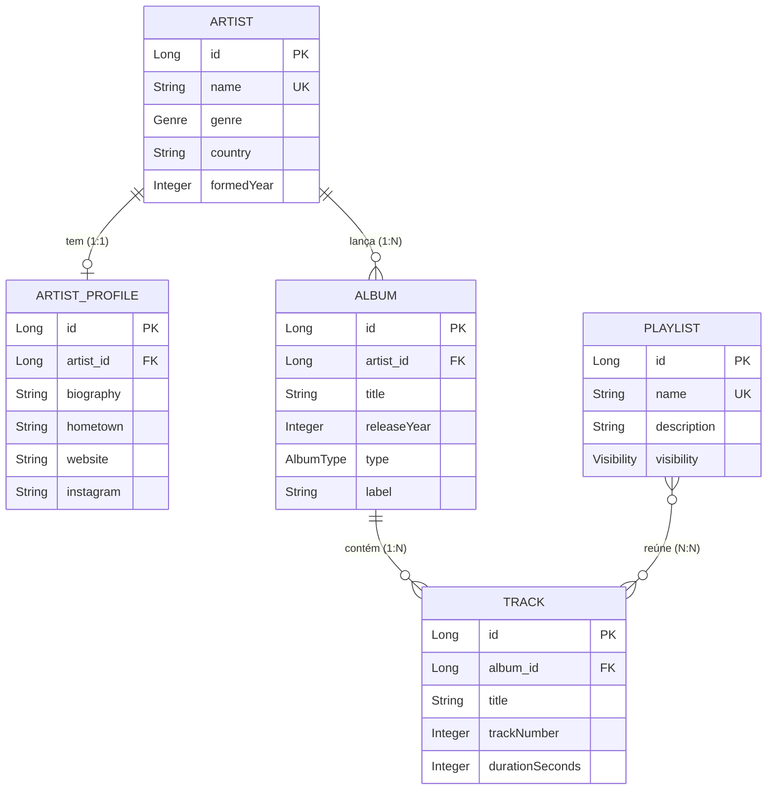

# Scene API

API REST da **cena musical**: cadastra e consulta artistas, perfis, álbuns, faixas e playlists, com paginação, validação, documentação Swagger e links HATEOAS. Os dados de exemplo são carregados pela classe `DataLoader` e usam artistas do perfil do autor no Last.fm (Bring Me the Horizon, Title Fight, Asking Alexandria, blessthefall, Alesana e I Promised the World).

> Projeto final da disciplina de **Web Services** (Senac TSI) — **Parte 1**.

## Sumário

- [Tecnologias](#tecnologias)
- [Como executar](#como-executar)
- [Dados iniciais](#dados-iniciais)
- [Modelo de dados](#modelo-de-dados)
- [Convenções da API](#convenções-da-api)
- [API Reference](#api-reference)
- [Estrutura do projeto](#estrutura-do-projeto)
- [Autor](#autor)

## Tecnologias

- Java 21 · Maven · Spring Boot 4.1.1
- Spring Web MVC · Spring Data JPA · Hibernate
- Bean Validation (Jakarta Validation)
- Spring HATEOAS (formato HAL)
- H2 (banco em memória)
- Springdoc OpenAPI / Swagger UI 3.1.1 (com tema customizado)

## Como executar

Requisitos: **JDK 21 ou superior**. O Maven já vem junto no projeto (`mvnw`).

```bash
# Linux / macOS
./mvnw spring-boot:run

# Windows
mvnw.cmd spring-boot:run
```

A API sobe em `http://localhost:8080`; abrir a raiz já redireciona para o Swagger.

| Recurso | URL |
| :-- | :-- |
| Swagger UI | http://localhost:8080/swagger-ui/index.html |
| OpenAPI (JSON) | http://localhost:8080/v3/api-docs |
| Console do H2 | http://localhost:8080/h2-console |

Console do H2: JDBC URL `jdbc:h2:mem:scenedb`, usuário `sa`, senha em branco.

Teste automatizado do Spring (sobe o contexto inteiro com o H2 e a carga inicial): `./mvnw test`.

### Coleção do Postman

A coleção está em [`postman/scene-api.postman_collection.json`](postman/scene-api.postman_collection.json): **85 requisições** (os 40 endpoints, 3 passos extras de fluxo e 42 casos de erro `400`, `404`, `405`, `409` e `415`), agrupadas em 7 pastas.

1. No Postman: **Import** → selecione o arquivo `.json`.
2. Suba a aplicação (`http://localhost:8080`). A variável `baseUrl` já vem configurada.
3. Rode as pastas de **1 a 7**, de cima para baixo (ou use o **Collection Runner**). Os ids criados são guardados automaticamente em variáveis (`artistId`, `profileId`, `albumId`, `trackId`, `track2Id` e `playlistId`) e cada requisição tem testes de status, de corpo e de links HATEOAS.

| Pasta | O que faz |
| :-- | :-- |
| 1. Artists | CRUD de artistas, buscas e erros de validação |
| 2. Artist Profiles | Perfil do artista criado na pasta 1 (relação 1:1) |
| 3. Albums | Álbuns do artista (relação 1:N) |
| 4. Tracks | Faixas do álbum (relação 1:N) |
| 5. Playlists | Playlists e faixas dentro delas (relação N:N) |
| 6. Erros gerais | Rota inexistente, método e Content-Type errados, JSON ruim, ordenação inválida |
| 7. Limpeza | Remove o que foi criado e confere as cascatas; depois dela a coleção roda de novo do zero |

## Dados iniciais

O H2 é **em memória**: os dados somem ao encerrar a aplicação. Por isso, ao subir (e somente se ainda não houver nenhum artista), a classe `DataLoader` cadastra automaticamente:

- 6 artistas: Bring Me the Horizon, Title Fight, Asking Alexandria, blessthefall, Alesana, I Promised The World;
- 5 perfis (o de *I Promised The World* fica de fora de propósito, para dar para testar o `POST /artist-profiles` e o `404` por artista);
- 8 álbuns, incluindo um EP sem faixas (serve para testar a consulta por formato);
- 82 faixas, com número e duração;
- 4 playlists, ligando faixas de álbuns diferentes (relação N:N): *Heavy Rotation* (PUBLIC), *Treino Pesado* (PRIVATE), *Curtas e Grossas* (PUBLIC), *Madrugada* (PRIVATE).

## Modelo de dados



| Entidade | Descrição | Relacionamentos |
| :-- | :-- | :-- |
| `Artist` | Artista ou banda | 1:1 com `ArtistProfile`; 1:N com `Album` |
| `ArtistProfile` | Biografia, cidade natal, site e Instagram do artista | 1:1 com `Artist` |
| `Album` | Álbum, EP, single, coletânea ou show ao vivo | N:1 com `Artist`; 1:N com `Track` |
| `Track` | Faixa de um álbum | N:1 com `Album`; N:N com `Playlist` |
| `Playlist` | Lista de faixas de qualquer artista ou álbum | N:N com `Track` (tabela `playlist_tracks`) |

Enums: `Genre` (`ROCK`, `ALTERNATIVE`, `PUNK`, `EMO`, `POST_HARDCORE`, `METALCORE`, `METAL`, `POP`, `HIP_HOP`, `ELECTRONIC`, `JAZZ`, `FOLK`, `CLASSICAL`, `OTHER`), `AlbumType` (`ALBUM`, `EP`, `SINGLE`, `COMPILATION`, `LIVE`), `Visibility` (`PUBLIC`, `PRIVATE`).

### Regras de validação

As mesmas regras valem na entrada (DTOs `*Request`) e nas entidades (Bean Validation). Textos são aparados (`trim`) antes de validar.

| Entidade | Campo | Regra |
| :-- | :-- | :-- |
| `Artist` | `name` | obrigatório; 2 a 100 caracteres; ao menos uma letra; único (sem diferenciar maiúsculas de minúsculas) |
| `Artist` | `genre` | obrigatório; enum `Genre` |
| `Artist` | `country` | opcional; 2 a 60 caracteres; somente letras, espaços e `. , ' -` |
| `Artist` | `formedYear` | opcional; de 1900 a 2100 |
| `ArtistProfile` | `artistId` | obrigatório; o artista precisa existir e ainda não ter perfil (1:1); não muda depois de criado |
| `ArtistProfile` | `biography` | obrigatório; 10 a 1000 caracteres |
| `ArtistProfile` | `hometown` | opcional; 2 a 100 caracteres; somente letras, espaços e `. , ' -` |
| `ArtistProfile` | `website` | opcional; até 200 caracteres; começa com `http://` ou `https://` |
| `ArtistProfile` | `instagram` | opcional; até 30 caracteres entre letras, números, `.` e `_` (sem o `@`) |
| `Album` | `artistId` | obrigatório; o artista precisa existir |
| `Album` | `title` | obrigatório; 1 a 150 caracteres; títulos numéricos como `1989` valem; único dentro do artista |
| `Album` | `releaseYear` | obrigatório; de 1900 a 2100 |
| `Album` | `type` | obrigatório; enum `AlbumType` |
| `Album` | `label` | opcional; 2 a 100 caracteres; ao menos uma letra |
| `Track` | `albumId` | obrigatório; o álbum precisa existir |
| `Track` | `title` | obrigatório; 1 a 150 caracteres; títulos numéricos como `27` valem |
| `Track` | `trackNumber` | obrigatório; de 1 a 99; único dentro do álbum |
| `Track` | `durationSeconds` | opcional; de 1 a 7200 |
| `Playlist` | `name` | obrigatório; 2 a 100 caracteres; ao menos uma letra; único (sem diferenciar maiúsculas de minúsculas) |
| `Playlist` | `description` | opcional; até 255 caracteres |
| `Playlist` | `visibility` | obrigatório; enum `Visibility` |

## Convenções da API

### Paginação

Todas as listagens (inclusive as buscas e as consultas por relação) são paginadas e aceitam os mesmos parâmetros de query: `page` (começa em 0), `size` (padrão 10, máximo 50) e `sort` (ex.: `sort=name,asc`). Um campo de ordenação que não existe devolve `400`.

### Links HATEOAS

Cada recurso traz `_links` com `self`, `update` e `delete`, a coleção e os recursos relacionados. As listagens vêm em `PagedModel` (itens em `_embedded`, mais `_links` de navegação e o bloco `page`). Exemplo (formato):

```json
{
  "id": 1,
  "name": "Bring Me the Horizon",
  "genre": "METALCORE",
  "country": "United Kingdom",
  "formedYear": 2004,
  "_links": {
    "self":    { "href": "http://localhost:8080/artists/1" },
    "update":  { "href": "http://localhost:8080/artists/1" },
    "delete":  { "href": "http://localhost:8080/artists/1" },
    "artists": { "href": "http://localhost:8080/artists" },
    "albums":  { "href": "http://localhost:8080/albums/by-artist/1" },
    "profile": { "href": "http://localhost:8080/artist-profiles/by-artist/1" }
  }
}
```

### Erros

Todo erro tem o mesmo corpo (`details` só vem preenchida nos erros de validação):

```json
{
  "status": 404,
  "error": "Not Found",
  "message": "Artista não encontrado(a) com id: 99",
  "path": "/artists/99",
  "timestamp": "2026-10-09T10:15:30",
  "details": []
}
```

Erro de validação, campo a campo:

```json
{
  "status": 400,
  "error": "Bad Request",
  "message": "Dados inválidos: 2 campo(s) com problema",
  "path": "/artists",
  "timestamp": "2026-10-09T10:15:30",
  "details": [
    { "field": "genre", "message": "não deve ser nulo" },
    { "field": "name", "message": "tamanho deve ser entre 2 e 100" }
  ]
}
```

| Status | Quando |
| :-- | :-- |
| `200 OK` | Consulta ou atualização bem-sucedida |
| `201 Created` | Recurso criado (o header `Location` aponta para ele) |
| `204 No Content` | Remoção bem-sucedida |
| `400 Bad Request` | Validação falhou, JSON malformado ou com texto onde se espera número, id ou enum inválido, parâmetro ausente ou em branco, campo de ordenação inexistente |
| `404 Not Found` | Recurso (ou artista/álbum/playlist/faixa referenciado) não existe, ou rota inexistente |
| `405 Method Not Allowed` | Verbo HTTP não suportado pela rota |
| `409 Conflict` | Valor único duplicado (nome de artista ou playlist, título de álbum no mesmo artista, número de faixa no mesmo álbum, perfil repetido, faixa já na playlist) |
| `415 Unsupported Media Type` | Corpo enviado com um Content-Type diferente de `application/json` |
| `500 Internal Server Error` | Só para falhas inesperadas, com mensagem genérica (nenhum dos casos acima chega aqui) |

## API Reference

São **40 endpoints**, em 5 grupos. A descrição completa de cada um (com exemplos de resposta de cada status) está no Swagger UI.

### Artists

Cadastro de artistas e bandas. Um artista tem vários álbuns (relação 1:N) e no máximo um perfil (relação 1:1).

#### Get all artists

```http
  GET /artists
```

Retorna uma página com os artistas cadastrados.

| Parameter | Type     | Description                |
| :-------- | :------- | :------------------------- |
| `page` | `integer` | Número da página, começando em 0 (padrão `0`) |
| `size` | `integer` | Itens por página (padrão `10`, máximo `50`) |
| `sort` | `string` | Ordenação no formato `campo,asc` ou `campo,desc`, ex.: `sort=name,asc`. Campos: `id`, `name`, `genre`, `country`, `formedYear` |

**Status:** `200` OK · `400` Bad Request

#### Search artists by name

```http
  GET /artists/search?name=${name}
```

Consulta personalizada: retorna os artistas cujo nome contém o texto informado, sem diferenciar maiúsculas de minúsculas. Ex.: name=bring encontra 'Bring Me the Horizon'.

| Parameter | Type     | Description                |
| :-------- | :------- | :------------------------- |
| `name` | `string` | **Required**. Parte do nome do artista (de 1 a 100 caracteres). Ex.: `bring` |
| `page` | `integer` | Número da página, começando em 0 (padrão `0`) |
| `size` | `integer` | Itens por página (padrão `10`, máximo `50`) |
| `sort` | `string` | Ordenação no formato `campo,asc` ou `campo,desc`, ex.: `sort=name,asc`. Campos: `id`, `name`, `genre`, `country`, `formedYear` |

**Status:** `200` OK · `400` Bad Request

#### Get artists by genre

```http
  GET /artists/by-genre/${genre}
```

Consulta personalizada: retorna os artistas do gênero informado. Valores aceitos: ROCK, ALTERNATIVE, PUNK, EMO, POST_HARDCORE, METALCORE, METAL, POP, HIP_HOP, ELECTRONIC, JAZZ, FOLK, CLASSICAL, OTHER.

| Parameter | Type     | Description                |
| :-------- | :------- | :------------------------- |
| `genre` | `string` | **Required**. Gênero musical. Valores: `ROCK`, `ALTERNATIVE`, `PUNK`, `EMO`, `POST_HARDCORE`, `METALCORE`, `METAL`, `POP`, `HIP_HOP`, `ELECTRONIC`, `JAZZ`, `FOLK`, `CLASSICAL`, `OTHER` |
| `page` | `integer` | Número da página, começando em 0 (padrão `0`) |
| `size` | `integer` | Itens por página (padrão `10`, máximo `50`) |
| `sort` | `string` | Ordenação no formato `campo,asc` ou `campo,desc`, ex.: `sort=name,asc`. Campos: `id`, `name`, `genre`, `country`, `formedYear` |

**Status:** `200` OK · `400` Bad Request

#### Get a specific artist

```http
  GET /artists/${id}
```

Retorna os dados de um único artista a partir do seu identificador, com links para álbuns e perfil.

| Parameter | Type     | Description                |
| :-------- | :------- | :------------------------- |
| `id` | `integer` | **Required**. Id do artista. Ex.: `1` |

**Status:** `200` OK · `400` Bad Request · `404` Not Found

#### Create an artist

```http
  POST /artists
```

Cria um artista. Nome (2 a 100 caracteres, único) e gênero são obrigatórios; país (somente letras) e ano de formação (1900 a 2100) são opcionais.

| Parameter | Type     | Description                |
| :-------- | :------- | :------------------------- |
| `name` | `string` | **Required**. Nome do artista ou banda (único, sem diferenciar maiúsculas de minúsculas). De 2 a 100 caracteres, com ao menos uma letra; aceita números e pontuação comum. |
| `genre` | `string` | **Required**. Gênero principal. Valores aceitos: ROCK, ALTERNATIVE, PUNK, EMO, POST_HARDCORE, METALCORE, METAL, POP, HIP_HOP, ELECTRONIC, JAZZ, FOLK, CLASSICAL, OTHER |
| `country` | `string` | País de origem (opcional). De 2 a 60 caracteres, somente letras, espaços e os símbolos . , ' - (números não são aceitos). |
| `formedYear` | `integer` | Ano de formação (opcional), de 1900 a 2100 |

Exemplo de corpo:

```json
{
  "name": "Sleeping with Sirens",
  "genre": "POST_HARDCORE",
  "country": "United States",
  "formedYear": 2009
}
```

**Status:** `201` Created · `400` Bad Request · `409` Conflict

#### Update an artist

```http
  PUT /artists/${id}
```

Substitui todos os dados de um artista existente. As mesmas regras de validação do cadastro se aplicam.

| Parameter | Type     | Description                |
| :-------- | :------- | :------------------------- |
| `id` | `integer` | **Required**. Id do artista a atualizar. Ex.: `1` |
| `name` | `string` | **Required**. Nome do artista ou banda (único, sem diferenciar maiúsculas de minúsculas). De 2 a 100 caracteres, com ao menos uma letra; aceita números e pontuação comum. |
| `genre` | `string` | **Required**. Gênero principal. Valores aceitos: ROCK, ALTERNATIVE, PUNK, EMO, POST_HARDCORE, METALCORE, METAL, POP, HIP_HOP, ELECTRONIC, JAZZ, FOLK, CLASSICAL, OTHER |
| `country` | `string` | País de origem (opcional). De 2 a 60 caracteres, somente letras, espaços e os símbolos . , ' - (números não são aceitos). |
| `formedYear` | `integer` | Ano de formação (opcional), de 1900 a 2100 |

**Status:** `200` OK · `400` Bad Request · `404` Not Found · `409` Conflict

#### Delete an artist

```http
  DELETE /artists/${id}
```

Exclui o artista junto com o perfil, os álbuns e as faixas dele. As faixas também saem de todas as playlists.

| Parameter | Type     | Description                |
| :-------- | :------- | :------------------------- |
| `id` | `integer` | **Required**. Id do artista a remover. Ex.: `1` |

**Status:** `204` No Content · `400` Bad Request · `404` Not Found

### Artist Profiles

Perfil detalhado de um artista (biografia, cidade natal, site e Instagram). Relação 1:1: cada artista tem no máximo um perfil.

#### Get all artist profiles

```http
  GET /artist-profiles
```

Retorna uma página com os perfis cadastrados.

| Parameter | Type     | Description                |
| :-------- | :------- | :------------------------- |
| `page` | `integer` | Número da página, começando em 0 (padrão `0`) |
| `size` | `integer` | Itens por página (padrão `10`, máximo `50`) |
| `sort` | `string` | Ordenação no formato `campo,asc` ou `campo,desc`, ex.: `sort=hometown,asc`. Campos: `id`, `hometown`, `website`, `instagram` |

**Status:** `200` OK · `400` Bad Request

#### Search artist profiles by hometown

```http
  GET /artist-profiles/search?hometown=${hometown}
```

Consulta personalizada: retorna os perfis cuja cidade natal contém o texto informado, sem diferenciar maiúsculas de minúsculas. Ex.: hometown=england encontra 'Sheffield, England' e 'York, England'.

| Parameter | Type     | Description                |
| :-------- | :------- | :------------------------- |
| `hometown` | `string` | **Required**. Parte da cidade natal (de 1 a 100 caracteres). Ex.: `england` |
| `page` | `integer` | Número da página, começando em 0 (padrão `0`) |
| `size` | `integer` | Itens por página (padrão `10`, máximo `50`) |
| `sort` | `string` | Ordenação no formato `campo,asc` ou `campo,desc`, ex.: `sort=hometown,asc`. Campos: `id`, `hometown`, `website`, `instagram` |

**Status:** `200` OK · `400` Bad Request

#### Get the profile of an artist

```http
  GET /artist-profiles/by-artist/${artistId}
```

Consulta personalizada: retorna o perfil do artista cujo id foi informado (relação 1:1).

| Parameter | Type     | Description                |
| :-------- | :------- | :------------------------- |
| `artistId` | `integer` | **Required**. Id do artista dono do perfil. Ex.: `1` |

**Status:** `200` OK · `400` Bad Request · `404` Not Found

#### Get a specific artist profile

```http
  GET /artist-profiles/${id}
```

Retorna os dados de um único perfil a partir do seu identificador.

| Parameter | Type     | Description                |
| :-------- | :------- | :------------------------- |
| `id` | `integer` | **Required**. Id do perfil. Ex.: `1` |

**Status:** `200` OK · `400` Bad Request · `404` Not Found

#### Create an artist profile

```http
  POST /artist-profiles
```

Cria o perfil de um artista que ainda não tem um. Obrigatórios: artistId (o artista precisa existir) e biography (10 a 1000 caracteres). Opcionais: hometown (somente letras), website (http:// ou https://) e instagram (sem o @).

| Parameter | Type     | Description                |
| :-------- | :------- | :------------------------- |
| `artistId` | `integer` | **Required**. Id do artista dono do perfil. O artista precisa existir e ainda não ter perfil; depois de criado, o perfil não pode mudar de artista. |
| `biography` | `string` | **Required**. Biografia do artista, de 10 a 1000 caracteres |
| `hometown` | `string` | Cidade natal (opcional). De 2 a 100 caracteres, somente letras, espaços e os símbolos . , ' - (números não são aceitos). |
| `website` | `string` | Site oficial (opcional). Precisa começar com http:// ou https://; até 200 caracteres. |
| `instagram` | `string` | Usuário do Instagram, sem o @ (opcional). Até 30 caracteres: letras, números, ponto e underline. |

Exemplo de corpo:

```json
{
  "artistId": 6,
  "biography": "Banda de Denton, Texas, formada em 2020, que já se chamou Sw!tch e Sinema.",
  "hometown": "Denton, Texas",
  "website": "https://www.example.com",
  "instagram": "iptw.example"
}
```

**Status:** `201` Created · `400` Bad Request · `404` Not Found · `409` Conflict

#### Update an artist profile

```http
  PUT /artist-profiles/${id}
```

Substitui os dados de um perfil existente. O artistId enviado precisa ser o mesmo do perfil: um perfil não muda de artista.

| Parameter | Type     | Description                |
| :-------- | :------- | :------------------------- |
| `id` | `integer` | **Required**. Id do perfil a atualizar. Ex.: `1` |
| `artistId` | `integer` | **Required**. Id do artista dono do perfil. O artista precisa existir e ainda não ter perfil; depois de criado, o perfil não pode mudar de artista. |
| `biography` | `string` | **Required**. Biografia do artista, de 10 a 1000 caracteres |
| `hometown` | `string` | Cidade natal (opcional). De 2 a 100 caracteres, somente letras, espaços e os símbolos . , ' - (números não são aceitos). |
| `website` | `string` | Site oficial (opcional). Precisa começar com http:// ou https://; até 200 caracteres. |
| `instagram` | `string` | Usuário do Instagram, sem o @ (opcional). Até 30 caracteres: letras, números, ponto e underline. |

**Status:** `200` OK · `400` Bad Request · `404` Not Found

#### Delete an artist profile

```http
  DELETE /artist-profiles/${id}
```

Exclui o perfil. O artista continua cadastrado e pode receber um novo perfil depois.

| Parameter | Type     | Description                |
| :-------- | :------- | :------------------------- |
| `id` | `integer` | **Required**. Id do perfil a remover. Ex.: `1` |

**Status:** `204` No Content · `400` Bad Request · `404` Not Found

### Albums

Cadastro de álbuns, EPs, singles, coletâneas e shows ao vivo. Cada álbum pertence a um artista (N:1) e tem várias faixas (1:N).

#### Get all albums

```http
  GET /albums
```

Retorna uma página com os álbuns cadastrados.

| Parameter | Type     | Description                |
| :-------- | :------- | :------------------------- |
| `page` | `integer` | Número da página, começando em 0 (padrão `0`) |
| `size` | `integer` | Itens por página (padrão `10`, máximo `50`) |
| `sort` | `string` | Ordenação no formato `campo,asc` ou `campo,desc`, ex.: `sort=title,asc`. Campos: `id`, `title`, `releaseYear`, `type`, `label` |

**Status:** `200` OK · `400` Bad Request

#### Search albums by title

```http
  GET /albums/search?title=${title}
```

Consulta personalizada: retorna os álbuns cujo título contém o texto informado, sem diferenciar maiúsculas de minúsculas. Ex.: title=scream encontra 'Stand Up and Scream'.

| Parameter | Type     | Description                |
| :-------- | :------- | :------------------------- |
| `title` | `string` | **Required**. Parte do título do álbum (de 1 a 150 caracteres). Ex.: `scream` |
| `page` | `integer` | Número da página, começando em 0 (padrão `0`) |
| `size` | `integer` | Itens por página (padrão `10`, máximo `50`) |
| `sort` | `string` | Ordenação no formato `campo,asc` ou `campo,desc`, ex.: `sort=title,asc`. Campos: `id`, `title`, `releaseYear`, `type`, `label` |

**Status:** `200` OK · `400` Bad Request

#### Get albums of an artist

```http
  GET /albums/by-artist/${artistId}
```

Consulta personalizada: retorna os álbuns do artista informado (relação 1:N).

| Parameter | Type     | Description                |
| :-------- | :------- | :------------------------- |
| `artistId` | `integer` | **Required**. Id do artista. Ex.: `1` |
| `page` | `integer` | Número da página, começando em 0 (padrão `0`) |
| `size` | `integer` | Itens por página (padrão `10`, máximo `50`) |
| `sort` | `string` | Ordenação no formato `campo,asc` ou `campo,desc`, ex.: `sort=title,asc`. Campos: `id`, `title`, `releaseYear`, `type`, `label` |

**Status:** `200` OK · `400` Bad Request · `404` Not Found

#### Get albums by type

```http
  GET /albums/by-type/${type}
```

Consulta personalizada: retorna os álbuns do formato informado. Valores aceitos: ALBUM, EP, SINGLE, COMPILATION, LIVE.

| Parameter | Type     | Description                |
| :-------- | :------- | :------------------------- |
| `type` | `string` | **Required**. Formato do lançamento. Valores: `ALBUM`, `EP`, `SINGLE`, `COMPILATION`, `LIVE` |
| `page` | `integer` | Número da página, começando em 0 (padrão `0`) |
| `size` | `integer` | Itens por página (padrão `10`, máximo `50`) |
| `sort` | `string` | Ordenação no formato `campo,asc` ou `campo,desc`, ex.: `sort=title,asc`. Campos: `id`, `title`, `releaseYear`, `type`, `label` |

**Status:** `200` OK · `400` Bad Request

#### Get a specific album

```http
  GET /albums/${id}
```

Retorna os dados de um único álbum a partir do seu identificador, com links para o artista e as faixas.

| Parameter | Type     | Description                |
| :-------- | :------- | :------------------------- |
| `id` | `integer` | **Required**. Id do álbum. Ex.: `1` |

**Status:** `200` OK · `400` Bad Request · `404` Not Found

#### Create an album

```http
  POST /albums
```

Cria um álbum para um artista existente. Obrigatórios: artistId, title (1 a 150 caracteres, único dentro do artista), releaseYear (1900 a 2100) e type. Opcional: label (gravadora).

| Parameter | Type     | Description                |
| :-------- | :------- | :------------------------- |
| `artistId` | `integer` | **Required**. Id do artista dono do álbum (o artista precisa existir) |
| `title` | `string` | **Required**. Título do álbum. De 1 a 150 caracteres: letras, números, espaços e pontuação comum (títulos numéricos como "1989" são válidos). Não pode repetir dentro do mesmo artista. |
| `releaseYear` | `integer` | **Required**. Ano de lançamento, de 1900 a 2100 |
| `type` | `string` | **Required**. Formato do lançamento. Valores aceitos: ALBUM, EP, SINGLE, COMPILATION, LIVE |
| `label` | `string` | Gravadora (opcional). De 2 a 100 caracteres, com ao menos uma letra. |

Exemplo de corpo:

```json
{
  "artistId": 1,
  "title": "That's the Spirit",
  "releaseYear": 2015,
  "type": "ALBUM",
  "label": "RCA Records"
}
```

**Status:** `201` Created · `400` Bad Request · `404` Not Found · `409` Conflict

#### Update an album

```http
  PUT /albums/${id}
```

Substitui todos os dados de um álbum existente (inclusive o artista dono). As mesmas regras de validação do cadastro se aplicam.

| Parameter | Type     | Description                |
| :-------- | :------- | :------------------------- |
| `id` | `integer` | **Required**. Id do álbum a atualizar. Ex.: `1` |
| `artistId` | `integer` | **Required**. Id do artista dono do álbum (o artista precisa existir) |
| `title` | `string` | **Required**. Título do álbum. De 1 a 150 caracteres: letras, números, espaços e pontuação comum (títulos numéricos como "1989" são válidos). Não pode repetir dentro do mesmo artista. |
| `releaseYear` | `integer` | **Required**. Ano de lançamento, de 1900 a 2100 |
| `type` | `string` | **Required**. Formato do lançamento. Valores aceitos: ALBUM, EP, SINGLE, COMPILATION, LIVE |
| `label` | `string` | Gravadora (opcional). De 2 a 100 caracteres, com ao menos uma letra. |

**Status:** `200` OK · `400` Bad Request · `404` Not Found · `409` Conflict

#### Delete an album

```http
  DELETE /albums/${id}
```

Exclui o álbum junto com as faixas dele. As faixas também saem de todas as playlists.

| Parameter | Type     | Description                |
| :-------- | :------- | :------------------------- |
| `id` | `integer` | **Required**. Id do álbum a remover. Ex.: `1` |

**Status:** `204` No Content · `400` Bad Request · `404` Not Found

### Tracks

Cadastro de faixas. Cada faixa pertence a um álbum (N:1) e pode estar em várias playlists (N:N).

#### Get all tracks

```http
  GET /tracks
```

Retorna uma página com as faixas cadastradas.

| Parameter | Type     | Description                |
| :-------- | :------- | :------------------------- |
| `page` | `integer` | Número da página, começando em 0 (padrão `0`) |
| `size` | `integer` | Itens por página (padrão `10`, máximo `50`) |
| `sort` | `string` | Ordenação no formato `campo,asc` ou `campo,desc`, ex.: `sort=title,asc`. Campos: `id`, `title`, `trackNumber`, `durationSeconds` |

**Status:** `200` OK · `400` Bad Request

#### Search tracks by title

```http
  GET /tracks/search?title=${title}
```

Consulta personalizada: retorna as faixas cujo título contém o texto informado, sem diferenciar maiúsculas de minúsculas. Ex.: title=heart encontra 'Can You Feel My Heart'.

| Parameter | Type     | Description                |
| :-------- | :------- | :------------------------- |
| `title` | `string` | **Required**. Parte do título da faixa (de 1 a 150 caracteres). Ex.: `heart` |
| `page` | `integer` | Número da página, começando em 0 (padrão `0`) |
| `size` | `integer` | Itens por página (padrão `10`, máximo `50`) |
| `sort` | `string` | Ordenação no formato `campo,asc` ou `campo,desc`, ex.: `sort=title,asc`. Campos: `id`, `title`, `trackNumber`, `durationSeconds` |

**Status:** `200` OK · `400` Bad Request

#### Get tracks of an album

```http
  GET /tracks/by-album/${albumId}
```

Consulta personalizada: retorna as faixas do álbum informado (relação 1:N). Use sort=trackNumber,asc para a ordem do disco.

| Parameter | Type     | Description                |
| :-------- | :------- | :------------------------- |
| `albumId` | `integer` | **Required**. Id do álbum. Ex.: `1` |
| `page` | `integer` | Número da página, começando em 0 (padrão `0`) |
| `size` | `integer` | Itens por página (padrão `10`, máximo `50`) |
| `sort` | `string` | Ordenação no formato `campo,asc` ou `campo,desc`, ex.: `sort=title,asc`. Campos: `id`, `title`, `trackNumber`, `durationSeconds` |

**Status:** `200` OK · `400` Bad Request · `404` Not Found

#### Get playlists of a track

```http
  GET /tracks/${id}/playlists
```

Consulta personalizada: retorna as playlists em que a faixa informada aparece (relação N:N).

| Parameter | Type     | Description                |
| :-------- | :------- | :------------------------- |
| `id` | `integer` | **Required**. Id da faixa. Ex.: `1` |
| `page` | `integer` | Número da página, começando em 0 (padrão `0`) |
| `size` | `integer` | Itens por página (padrão `10`, máximo `50`) |
| `sort` | `string` | Ordenação no formato `campo,asc` ou `campo,desc`, ex.: `sort=title,asc`. Campos: `id`, `title`, `trackNumber`, `durationSeconds` |

**Status:** `200` OK · `400` Bad Request · `404` Not Found

#### Get a specific track

```http
  GET /tracks/${id}
```

Retorna os dados de uma única faixa a partir do seu identificador, com links para o álbum e as playlists.

| Parameter | Type     | Description                |
| :-------- | :------- | :------------------------- |
| `id` | `integer` | **Required**. Id da faixa. Ex.: `1` |

**Status:** `200` OK · `400` Bad Request · `404` Not Found

#### Create a track

```http
  POST /tracks
```

Cria uma faixa em um álbum existente. Obrigatórios: albumId, title (1 a 150 caracteres) e trackNumber (1 a 99, único dentro do álbum). Opcional: durationSeconds (1 a 7200).

| Parameter | Type     | Description                |
| :-------- | :------- | :------------------------- |
| `albumId` | `integer` | **Required**. Id do álbum da faixa (o álbum precisa existir) |
| `title` | `string` | **Required**. Título da faixa. De 1 a 150 caracteres: letras, números, espaços e pontuação comum (títulos numéricos como "27" são válidos). |
| `trackNumber` | `integer` | **Required**. Número da faixa dentro do álbum, de 1 a 99. Não pode repetir dentro do mesmo álbum. |
| `durationSeconds` | `integer` | Duração em segundos (opcional), de 1 a 7200 |

Exemplo de corpo:

```json
{
  "albumId": 8,
  "title": "Intro",
  "trackNumber": 1,
  "durationSeconds": 95
}
```

**Status:** `201` Created · `400` Bad Request · `404` Not Found · `409` Conflict

#### Update a track

```http
  PUT /tracks/${id}
```

Substitui todos os dados de uma faixa existente (inclusive o álbum). As mesmas regras de validação do cadastro se aplicam.

| Parameter | Type     | Description                |
| :-------- | :------- | :------------------------- |
| `id` | `integer` | **Required**. Id da faixa a atualizar. Ex.: `1` |
| `albumId` | `integer` | **Required**. Id do álbum da faixa (o álbum precisa existir) |
| `title` | `string` | **Required**. Título da faixa. De 1 a 150 caracteres: letras, números, espaços e pontuação comum (títulos numéricos como "27" são válidos). |
| `trackNumber` | `integer` | **Required**. Número da faixa dentro do álbum, de 1 a 99. Não pode repetir dentro do mesmo álbum. |
| `durationSeconds` | `integer` | Duração em segundos (opcional), de 1 a 7200 |

**Status:** `200` OK · `400` Bad Request · `404` Not Found · `409` Conflict

#### Delete a track

```http
  DELETE /tracks/${id}
```

Exclui a faixa e a tira de todas as playlists em que estava.

| Parameter | Type     | Description                |
| :-------- | :------- | :------------------------- |
| `id` | `integer` | **Required**. Id da faixa a remover. Ex.: `1` |

**Status:** `204` No Content · `400` Bad Request · `404` Not Found

### Playlists

Cadastro de playlists e das faixas que fazem parte de cada uma. Relação N:N: uma playlist tem várias faixas e uma faixa pode estar em várias playlists.

#### Get all playlists

```http
  GET /playlists
```

Retorna uma página com as playlists cadastradas.

| Parameter | Type     | Description                |
| :-------- | :------- | :------------------------- |
| `page` | `integer` | Número da página, começando em 0 (padrão `0`) |
| `size` | `integer` | Itens por página (padrão `10`, máximo `50`) |
| `sort` | `string` | Ordenação no formato `campo,asc` ou `campo,desc`, ex.: `sort=name,asc`. Campos: `id`, `name`, `description`, `visibility` |

**Status:** `200` OK · `400` Bad Request

#### Search playlists by name

```http
  GET /playlists/search?name=${name}
```

Consulta personalizada: retorna as playlists cujo nome contém o texto informado, sem diferenciar maiúsculas de minúsculas. Ex.: name=rotation encontra 'Heavy Rotation'.

| Parameter | Type     | Description                |
| :-------- | :------- | :------------------------- |
| `name` | `string` | **Required**. Parte do nome da playlist (de 1 a 100 caracteres). Ex.: `rotation` |
| `page` | `integer` | Número da página, começando em 0 (padrão `0`) |
| `size` | `integer` | Itens por página (padrão `10`, máximo `50`) |
| `sort` | `string` | Ordenação no formato `campo,asc` ou `campo,desc`, ex.: `sort=name,asc`. Campos: `id`, `name`, `description`, `visibility` |

**Status:** `200` OK · `400` Bad Request

#### Get playlists by visibility

```http
  GET /playlists/by-visibility/${visibility}
```

Consulta personalizada: retorna as playlists PUBLIC ou PRIVATE.

| Parameter | Type     | Description                |
| :-------- | :------- | :------------------------- |
| `visibility` | `string` | **Required**. Visibilidade da playlist. Valores: `PUBLIC`, `PRIVATE` |
| `page` | `integer` | Número da página, começando em 0 (padrão `0`) |
| `size` | `integer` | Itens por página (padrão `10`, máximo `50`) |
| `sort` | `string` | Ordenação no formato `campo,asc` ou `campo,desc`, ex.: `sort=name,asc`. Campos: `id`, `name`, `description`, `visibility` |

**Status:** `200` OK · `400` Bad Request

#### Get tracks of a playlist

```http
  GET /playlists/${id}/tracks
```

Consulta personalizada: retorna as faixas que fazem parte da playlist informada (relação N:N).

| Parameter | Type     | Description                |
| :-------- | :------- | :------------------------- |
| `id` | `integer` | **Required**. Id da playlist. Ex.: `1` |
| `page` | `integer` | Número da página, começando em 0 (padrão `0`) |
| `size` | `integer` | Itens por página (padrão `10`, máximo `50`) |
| `sort` | `string` | Ordenação no formato `campo,asc` ou `campo,desc`, ex.: `sort=name,asc`. Campos: `id`, `name`, `description`, `visibility` |

**Status:** `200` OK · `400` Bad Request · `404` Not Found

#### Get a specific playlist

```http
  GET /playlists/${id}
```

Retorna os dados de uma única playlist a partir do seu identificador, com a quantidade de faixas e o link para elas.

| Parameter | Type     | Description                |
| :-------- | :------- | :------------------------- |
| `id` | `integer` | **Required**. Id da playlist. Ex.: `1` |

**Status:** `200` OK · `400` Bad Request · `404` Not Found

#### Create a playlist

```http
  POST /playlists
```

Cria uma playlist vazia. Nome (2 a 100 caracteres, único) e visibilidade são obrigatórios; descrição (até 255 caracteres) é opcional. Para colocar faixas nela, use POST /playlists/{playlistId}/tracks/{trackId}.

| Parameter | Type     | Description                |
| :-------- | :------- | :------------------------- |
| `name` | `string` | **Required**. Nome da playlist (único, sem diferenciar maiúsculas de minúsculas). De 2 a 100 caracteres, com ao menos uma letra; aceita números e pontuação comum. |
| `description` | `string` | Descrição (opcional), até 255 caracteres |
| `visibility` | `string` | **Required**. Quem pode ver a playlist. Valores aceitos: PUBLIC, PRIVATE |

Exemplo de corpo:

```json
{
  "name": "Road Trip Mix",
  "description": "Músicas para viagens longas",
  "visibility": "PUBLIC"
}
```

**Status:** `201` Created · `400` Bad Request · `409` Conflict

#### Update a playlist

```http
  PUT /playlists/${id}
```

Substitui nome, descrição e visibilidade de uma playlist existente. As faixas dela não mudam.

| Parameter | Type     | Description                |
| :-------- | :------- | :------------------------- |
| `id` | `integer` | **Required**. Id da playlist a atualizar. Ex.: `1` |
| `name` | `string` | **Required**. Nome da playlist (único, sem diferenciar maiúsculas de minúsculas). De 2 a 100 caracteres, com ao menos uma letra; aceita números e pontuação comum. |
| `description` | `string` | Descrição (opcional), até 255 caracteres |
| `visibility` | `string` | **Required**. Quem pode ver a playlist. Valores aceitos: PUBLIC, PRIVATE |

**Status:** `200` OK · `400` Bad Request · `404` Not Found · `409` Conflict

#### Delete a playlist

```http
  DELETE /playlists/${id}
```

Exclui a playlist. As faixas continuam cadastradas; só deixam de fazer parte dela.

| Parameter | Type     | Description                |
| :-------- | :------- | :------------------------- |
| `id` | `integer` | **Required**. Id da playlist a remover. Ex.: `1` |

**Status:** `204` No Content · `400` Bad Request · `404` Not Found

#### Add a track to a playlist

```http
  POST /playlists/${playlistId}/tracks/${trackId}
```

Coloca uma faixa existente na playlist (relação N:N). Devolve a playlist atualizada; o cabeçalho Location aponta para a lista de faixas dela.

| Parameter | Type     | Description                |
| :-------- | :------- | :------------------------- |
| `playlistId` | `integer` | **Required**. Id da playlist. Ex.: `1` |
| `trackId` | `integer` | **Required**. Id da faixa a adicionar. Ex.: `5` |

**Status:** `201` Created · `400` Bad Request · `404` Not Found · `409` Conflict

#### Remove a track from a playlist

```http
  DELETE /playlists/${playlistId}/tracks/${trackId}
```

Tira a faixa da playlist. A faixa continua cadastrada e em outras playlists.

| Parameter | Type     | Description                |
| :-------- | :------- | :------------------------- |
| `playlistId` | `integer` | **Required**. Id da playlist. Ex.: `1` |
| `trackId` | `integer` | **Required**. Id da faixa a remover. Ex.: `5` |

**Status:** `204` No Content · `400` Bad Request · `404` Not Found

## Estrutura do projeto

```text
src/main/java/com/vinicius/scene_api
├── SceneApiApplication.java
├── assembler/    monta os links HATEOAS de cada recurso
├── config/       carga inicial (DataLoader), OpenAPI/Swagger e redirecionamento da raiz
├── controller/   endpoints REST e a documentação de cada um (@Operation, @ApiResponse)
├── dto/          *Request (entrada validada), *Response (saída) e exemplos de erro
├── exception/    exceções de negócio, corpo padrão de erro (ApiError) e GlobalExceptionHandler
├── model/        entidades JPA e enums
├── repository/   Spring Data JPA (consultas derivadas e paginadas)
├── service/      regras de negócio e transações
└── validation/   expressões regulares e mensagens compartilhadas

src/main/resources
├── application.properties
└── static/       tema do Swagger UI (CSS, fontes e imagens)

postman/         coleção do Postman
```

## Autor

**Vinicius** — Senac TSI, projeto final da disciplina de Web Services.
